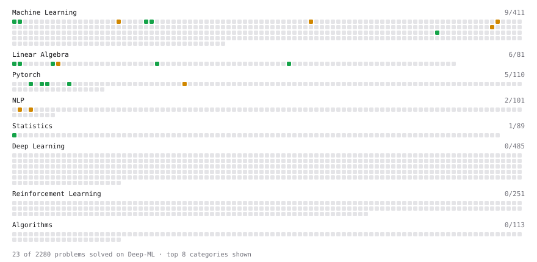

# Deep-ML

My machine learning practice from [Deep-ML](https://www.deep-ml.com). Every solution here was written by hand.

**20** solved · 20 problems · 0 labs · 0 math

[**Browse the interactive portfolio**](https://dek0o.github.io/deep-ml/) to replay this filling in over time.

## Problems

| | Difficulty | Solved | |
| --- | --- | --- | --- |
| [Build a Linear Regression Model with nn.Module](https://www.deep-ml.com/problems/885) | easy | 2026-11-10 | [solution](problems/0885-build-a-linear-regression-model-with-nn-module) |
| [Calculate 2x2 Matrix Inverse](https://www.deep-ml.com/problems/8) | easy | 2026-11-06 | [solution](problems/0008-calculate-2x2-matrix-inverse) |
| [Calculate Cosine Similarity Between Vectors](https://www.deep-ml.com/problems/76) | easy | 2026-11-06 | [solution](problems/0076-calculate-cosine-similarity-between-vectors) |
| [Calculate Covariance Matrix](https://www.deep-ml.com/problems/10) | easy | 2026-11-06 | [solution](problems/0010-calculate-covariance-matrix) |
| [Calculate R-squared for Regression Analysis](https://www.deep-ml.com/problems/69) | easy | 2026-11-08 | [solution](problems/0069-calculate-r-squared-for-regression-analysis) |
| [Calculate Root Mean Square Error (RMSE)](https://www.deep-ml.com/problems/71) | easy | 2026-11-08 | [solution](problems/0071-calculate-root-mean-square-error-rmse) |
| [Implement a Linear Layer Forward Pass with Matrix Multiplication](https://www.deep-ml.com/problems/883) | easy | 2026-11-09 | [solution](problems/0883-implement-a-linear-layer-forward-pass-with-matrix-multiplication) |
| [L2 Normalization Along an Axis](https://www.deep-ml.com/problems/1022) | easy | 2026-11-06 | [solution](problems/1022-l2-normalization-along-an-axis) |
| [Linear Regression Using Gradient Descent](https://www.deep-ml.com/problems/15) | easy | 2026-11-07 | [solution](problems/0015-linear-regression-using-gradient-descent) |
| [Linear Regression Using Normal Equation](https://www.deep-ml.com/problems/14) | easy | 2026-11-06 | [solution](problems/0014-linear-regression-using-normal-equation) |
| [Matrix-Vector Dot Product](https://www.deep-ml.com/problems/1) | easy | 2026-11-06 | [solution](problems/0001-matrix-vector-dot-product) |
| [Run One Training Step: Forward, Loss, Backward, Optimizer](https://www.deep-ml.com/problems/886) | easy | 2026-11-10 | [solution](problems/0886-run-one-training-step-forward-loss-backward-optimizer) |
| [Transpose of a Matrix](https://www.deep-ml.com/problems/2) | easy | 2026-11-06 | [solution](problems/0002-transpose-of-a-matrix) |
| [BM25 Ranking ](https://www.deep-ml.com/problems/90) | medium | 2026-11-06 | [solution](problems/0090-bm25-ranking) |
| [Implement Gradient Descent Variants with MSE Loss](https://www.deep-ml.com/problems/47) | medium | 2026-11-07 | [solution](problems/0047-implement-gradient-descent-variants-with-mse-loss) |
| [Implement TF-IDF (Term Frequency-Inverse Document Frequency)](https://www.deep-ml.com/problems/60) | medium | 2026-11-06 | [solution](problems/0060-implement-tf-idf-term-frequency-inverse-document-frequency) |
| [Implement the Huber Loss Function](https://www.deep-ml.com/problems/192) | medium | 2026-11-08 | [solution](problems/0192-implement-the-huber-loss-function) |
| [Matrix times Matrix ](https://www.deep-ml.com/problems/9) | medium | 2026-11-06 | [solution](problems/0009-matrix-times-matrix) |
| [Numerical Gradient Checking](https://www.deep-ml.com/problems/313) | medium | 2026-11-07 | [solution](problems/0313-numerical-gradient-checking) |
| [Stochastic Gradient Descent Step for Linear Regression](https://www.deep-ml.com/problems/802) | medium | 2026-11-07 | [solution](problems/0802-stochastic-gradient-descent-step-for-linear-regression) |

---

_This file is regenerated by Deep-ML on every push._
